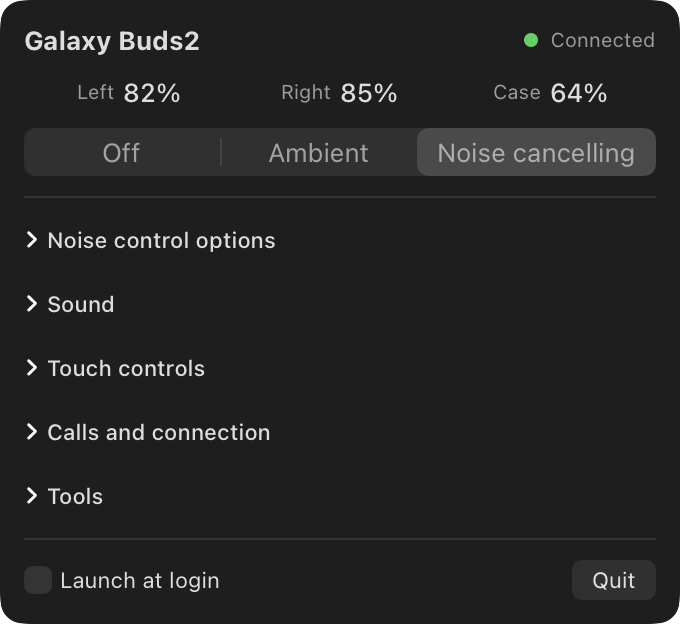
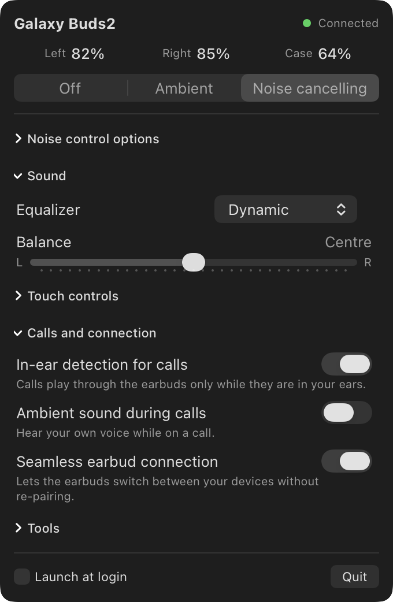
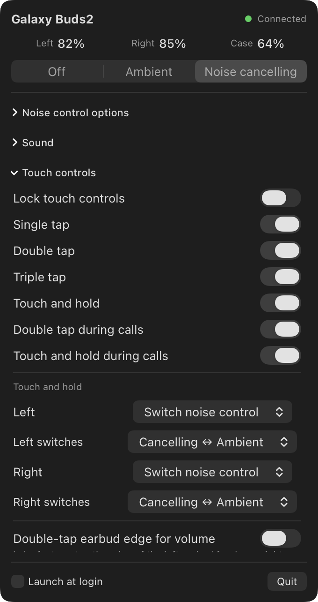
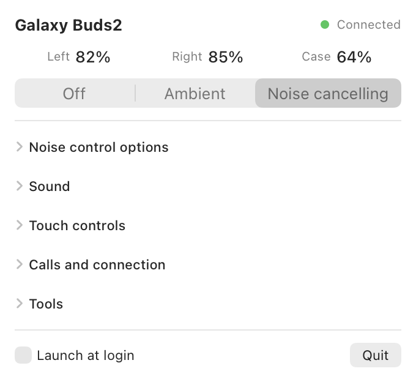

# MacBuds

Control Samsung **Galaxy Buds2** from macOS: a menu bar app and a command-line tool, for
people whose earbuds outlived their Android phone.

Samsung only ships the Buds2 settings app for Android. Without it you cannot change the
equalizer, the touch controls, or most of anything else. MacBuds speaks the same Bluetooth
protocol that app uses, so the settings are stored on the earbuds themselves and stay put
when you move them to another device.

<p align="center">
  
  
</p>

## What it can do

- **Battery** for left, right and case, in the menu bar and the popover
- **Noise control**: noise cancelling, ambient sound, off; ambient level; custom ambient
  sound per ear; noise control with a single earbud
- **Sound**: equalizer presets, left/right balance
- **Touch controls**: lock, per-gesture switches, what touch-and-hold does on each earbud,
  which two noise modes a hold switches between, double-tap-edge volume
- **Calls and connection**: in-ear detection for calls, ambient sound during calls, seamless
  earbud connection
- **Tools**: find my earbuds, earbud fit test, firmware version, serial numbers

<p align="center">
  
  
</p>

### What it will not do

It cannot update firmware, factory-reset, or reboot the earbuds, on purpose. The code only
transmits an explicit allowlist of documented settings messages
(`MessageID.sendable`); everything else is refused before it reaches Bluetooth.

## Status

Built for and tested on one pair of Galaxy Buds2 (SM-R177, firmware `R177XXU0AWB1`) on
macOS 26 with Apple Silicon. Every setting was verified by writing it and reading it back.
Still unproven: find my earbuds and the fit test (implemented from the reference, not yet
exercised), and whether the experimental ANC level switch is audible.
[`docs/BUILD_PLAN.md`](docs/BUILD_PLAN.md) lists exactly what has and has not been checked.

Other Galaxy Buds models use different message layouts and are not supported.

## Requirements

- macOS 14 or later (developed on macOS 26), Xcode with Swift 6
- Galaxy Buds2, paired with the Mac in System Settings › Bluetooth and connected

There is no prebuilt download; you build it from source, which takes about a minute.

## Menu bar app

```bash
git clone https://github.com/memoliertorerr/MacBuds.git
cd MacBuds
scripts/bundle.sh --open
```

This builds `dist/MacBuds.app` and launches it. The first time, macOS asks whether MacBuds
may use Bluetooth; allow it. An earbuds icon appears in the menu bar with the lower of the
two earbud battery levels next to it.

To keep it:

```bash
scripts/bundle.sh --install
```

copies it to `/Applications`. After that you can tick **Launch at login** in the popover.

MacBuds finds your earbuds by name among the Mac's paired devices. When they go back in the
case or connect to another device, the app says so and reconnects within a few seconds of
them coming back.

**About signing.** If your keychain has an Apple Development certificate, the app is signed
with it, which keeps the Bluetooth permission valid across rebuilds. Otherwise it is ad-hoc
signed, and after a rebuild macOS may ask again, or the app may report that no earbuds are
paired until you re-allow it in System Settings › Privacy & Security › Bluetooth.

## Command line

```bash
scripts/macbuds-bundled.sh status
```

Use the wrapper script rather than the bare binary: macOS silently kills a command-line tool
that touches Bluetooth unless the app that launched it declares Bluetooth use. The script
runs the tool inside a tiny app bundle so it gets its own permission.

**The earbuds accept one control connection at a time.** Quit MacBuds.app before using the
CLI.

| Command | What it does |
|---|---|
| `status [--json] [--watch [--seconds N]]` | Battery, placement and every setting |
| `noise anc\|ambient\|off` | Noise control mode (earbuds must be worn) |
| `ambient-level 0\|1\|2` | How much outside sound ambient mode lets in |
| `custom-ambient [on\|off] [--left 0-2] [--right 0-2] [--tone 0-4]` | Per-ear ambient level and tone |
| `one-earbud-noise on\|off` | Allow noise control with a single earbud |
| `anc-level high\|low` | Experimental: a Buds Pro setting the Buds2 accept; effect unproven |
| `noise-cycle [--left a+b] [--right a+b]` | Modes a touch-and-hold switches between, e.g. `anc+ambient` |
| `eq normal\|bass-boost\|soft\|dynamic\|clear\|treble-boost` | Equalizer preset |
| `balance 0-32` | Left/right balance, 16 is centre |
| `touch lock on\|off` | Lock every touch control |
| `touch gesture <name> on\|off` | `single-tap`, `double-tap`, `triple-tap`, `hold`, `double-tap-in-call`, `hold-in-call` |
| `touch hold [--left <action>] [--right <action>]` | `voice-assistant`, `noise-control`, `volume`, `spotify` |
| `double-tap-edge on\|off` | Labs: double-tap the earbud edge for volume |
| `in-ear-detection on\|off` | Calls go to the earbuds only while worn |
| `call-ambient on\|off` | Hear your own voice on calls |
| `seamless on\|off` | Seamless earbud connection |
| `find start [--seconds N] [--force]`, `find stop` | Make the earbuds beep (loud) |
| `fit-test` | Earbud fit test; wear both |
| `info` | Firmware, hardware revision, serial numbers, model |
| `probe [--channel N]` | Debug: list Bluetooth services, dump raw frames (listen only) |

Add `--verbose` to print the raw frames the earbuds send back. If more than one pair of
Buds2 is paired with your Mac, pick one with `--address` or the `MACBUDS_ADDRESS`
environment variable.

## How it works

The Buds2 expose a serial (RFCOMM) service over Bluetooth classic. Open it and they
immediately send a status frame with every setting, then accept one small framed message per
setting change. [`docs/PROTOCOL.md`](docs/PROTOCOL.md) documents the frame layout, checksum,
every message MacBuds uses, how the earbuds answer each one, and the messages that must
never be sent. Everything in it marked `[device]` was observed on real earbuds.

The package has four targets:

| Target | What it holds |
|---|---|
| `BudsProtocol` | Framing, checksum, message layouts. Pure Swift, unit-tested against frames captured from real earbuds |
| `BudsTransport` | Finding the earbuds and holding the RFCOMM session (IOBluetooth) |
| `macbuds` | The CLI |
| `MacBudsApp` | The SwiftUI menu bar app |

```bash
swift build && swift test
```

The README screenshots are rendered from the real views with sample data:

```bash
.build/debug/MacBudsApp --render-screenshots docs/images
```

## Why there is no iPhone version

iOS only lets apps open this kind of Bluetooth connection to Apple-certified (MFi)
accessories, which the Buds2 are not.

## Credits and license

Protocol knowledge comes from the open-source
[GalaxyBudsClient](https://github.com/timschneeb/GalaxyBudsClient) project, which
reverse-engineered it first and supports many more models, and from observing real earbuds.
MacBuds is an independent implementation; no code was copied.

Not affiliated with or endorsed by Samsung. "Galaxy Buds" is a trademark of Samsung
Electronics. You use this at your own risk.

Released under the [MIT License](LICENSE).
